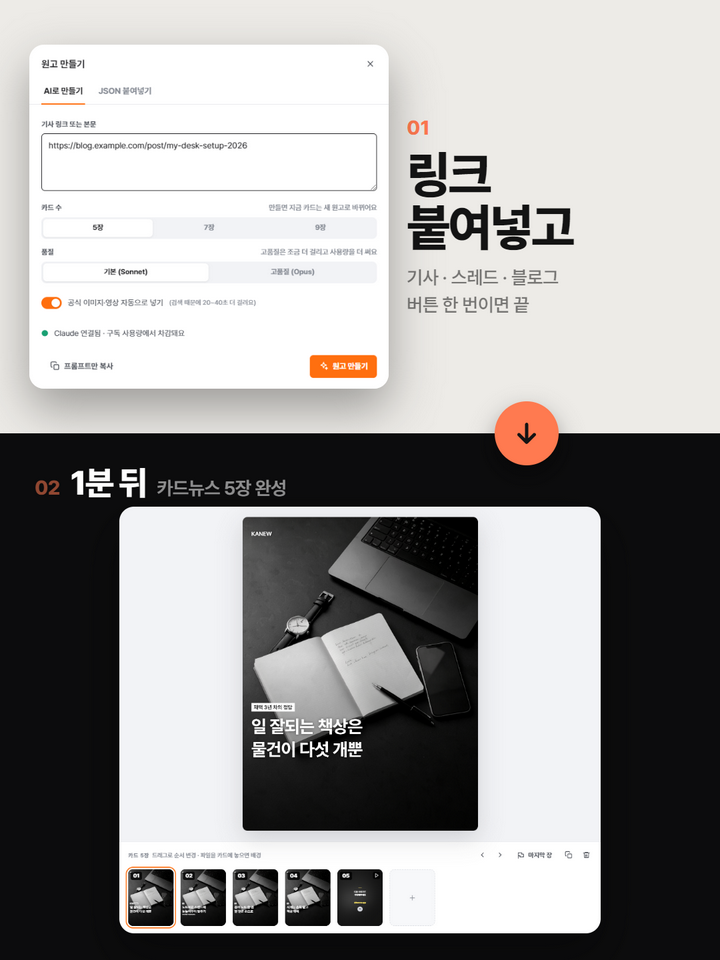
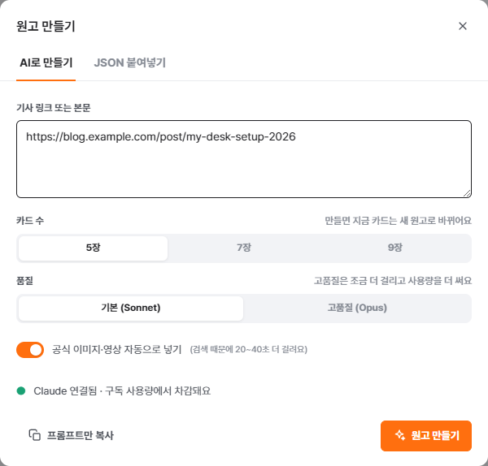
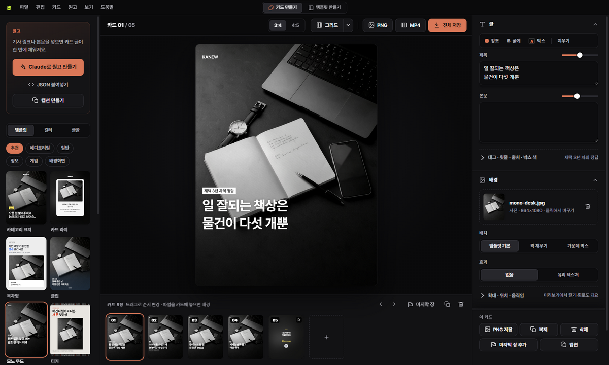
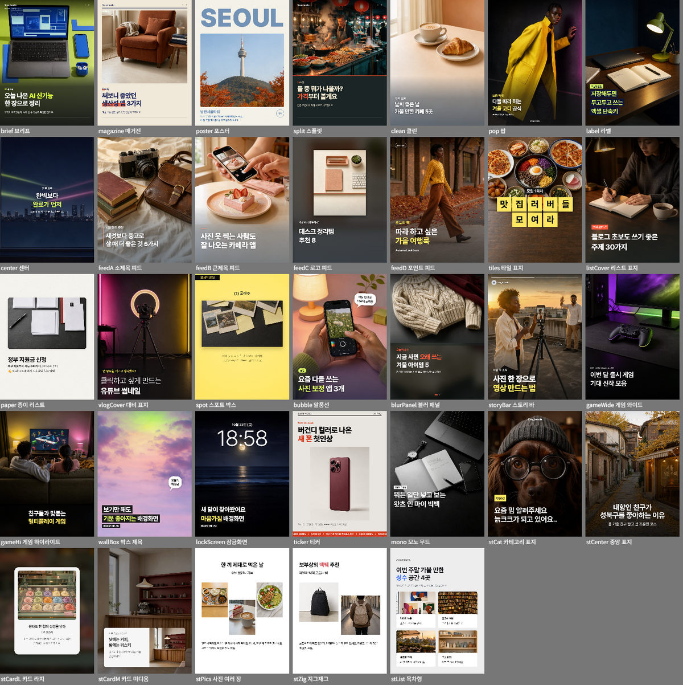
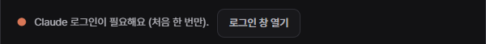

# 카뉴 (Kanew)

**기사·블로그·Threads 링크 하나로 인스타그램 카드뉴스를 만드는 Windows 앱입니다.**
원고 작성 → 사진·영상 수집 → 템플릿 배치 → PNG·MP4 저장까지 한 번에 처리합니다.

**[⬇ Windows용 무료 다운로드 (Kanew.exe)](https://github.com/echidna08/kanew/releases/latest/download/Kanew.exe)** · [소개 페이지](https://echidna08.github.io/kanew/)

---

## 필요한 것

| 항목 | 내용 |
|---|---|
| 운영체제 | Windows 10 / 11 (설치 없이 바로 실행되는 포터블 exe) |
| AI | **Claude Pro 이상 구독** + **Claude Code** |
| AI 사용료 | 별도 없음. 원고는 내 PC에서 내 Claude 계정으로 만들어지고, 내 구독 사용량에서 차감됩니다 |

> **Claude Desktop 앱이 아니라 Claude Code가 필요합니다.**
> Claude Code는 명령어로 실행하는 별도 프로그램입니다. Claude 무료 플랜에서는 쓸 수 없고 Pro·Max 이상 구독이 필요합니다.
> 설치 방법: [Claude Code 설치 안내](https://docs.claude.com/en/docs/claude-code/setup)

---

## 사용 방법

### 1. 실행하고 Claude 연결 확인

`Kanew.exe`를 더블클릭하면 바로 실행됩니다.
처음 실행할 때 Windows가 **'알 수 없는 게시자'** 경고를 띄우면 **추가 정보 → 실행**을 누릅니다. (베타라 아직 코드 서명 전입니다)

왼쪽 위 **Claude로 원고 만들기**를 누르고, 창 아래에 초록 불이 들어오면 준비 완료입니다.

### 2. 링크 붙여넣고 '원고 만들기'

- **기사 링크 또는 본문** 칸에 링크를 붙여넣습니다. 본문을 통째로 붙여넣어도 됩니다.
- **카드 수**(5·7·9장)와 **품질**(기본 Sonnet / 고품질 Opus)을 고릅니다.
- **공식 이미지·영상 자동으로 넣기**를 켜 두면 기사 속 사진·영상을 찾아 카드에 넣습니다.
- **원고 만들기**를 누르면 보통 1분 안팎으로 카드 세트가 완성됩니다.

**읽을 수 있는 링크**

| 링크 | 지원 |
|---|---|
| 뉴스 기사, 회사 블로그·보도자료, 티스토리·브런치 등 일반 웹페이지 | ✅ |
| 네이버 블로그 (`blog.naver.com`, `naver.me` 짧은 링크 포함) | ✅ |
| Threads 게시물 (작성자 본문·답글 영상·일부 댓글) | ✅ |
| 인스타그램·X·페이스북 (로그인이 필요한 곳) | ❌ → 본문을 복사해 붙여넣기 |
| 유료 구독 기사 | 열려 있는 부분만 |

### 3. 다듬고 저장

- **왼쪽:** 템플릿·컬러·글꼴 변경. 템플릿을 누르면 모든 카드에 바로 적용됩니다.
- **가운데:** 미리보기. 사진은 끌어다 놓거나 `Ctrl+V`로 붙여넣고, 글자는 끌어서 옮깁니다.
- **오른쪽:** 제목·본문 수정, 배경 사진, 마지막 장(팔로우 유도) 디자인.
- **비율:** 상단 `3:4`(1080×1440, 기본) / `4:5`(1080×1350) 전환.
- **저장:** `전체 저장`으로 폴더를 고르면 카드마다 PNG(사진)·MP4(영상)로 저장되고 폴더가 열립니다.

---

## 템플릿

인스타 카드뉴스용 템플릿 30여 종이 들어 있습니다. 같은 원고에 템플릿만 바꿔 분위기를 바꿀 수 있습니다.

- 템플릿 만들기 탭에서 나만의 템플릿을 직접 만들고, 템플릿 파일(`.cntpl`)로 주고받을 수 있습니다.
- 템플릿 미리보기 사진은 모두 AI(FLUX 3 Image Klein)로 만든 이미지입니다.

---

## 문제가 생겼을 때

| 화면에 보이는 것 | 원인 | 해결 |
|---|---|---|
|  | Claude Code가 설치되지 않음 | **설치 안내** → 설치 후 **다시 확인** |
|  | Claude Code 로그인 전 | **로그인 창 열기** → 브라우저에서 로그인하면 자동으로 연결 |
| "Claude 사용량 한도에 걸렸어요" | 구독 사용량 한도 도달 | 몇 시간 뒤 다시 시도 |
| "Claude Code를 쓸 수 없는 요금제예요" | 무료 플랜 등 | Claude Pro 이상 구독 |
| "Claude 서버가 바빠요" | Claude 서버 혼잡 | 잠시 뒤 다시 시도 |
| 링크를 넣었는데 내용이 비어 있음 | 로그인이 필요한 사이트 | 본문을 복사해서 붙여넣기 |

- 작업 내용은 PC에 자동 저장됩니다. 다시 켜면 **이어서 하기 / 새로 시작**을 고를 수 있습니다.
- 다른 PC로 옮기거나 보관하려면 **파일 → 프로젝트 저장**을 사용합니다.

---

## 알아둘 것

- 만든 카드의 저작권은 만든 사람에게 있습니다. 원본 기사·블로그의 글과 사진은 각 저작권자의 것이므로 게시 전에 출처를 확인하고 표기합니다.
- 맥(macOS)은 아직 지원하지 않습니다.
- Claude는 Anthropic의 상표이며, 카뉴는 Anthropic과 관련이 없습니다.
